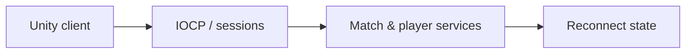

# CodeName VAIS — Game Server

[English](README.md) · [Korean](README.ko.md) · [Japanese](README.ja.md)

**C++ · Windows IOCP · C# · Unity** · 開発中

[開発事例を見る](https://ysl-ryudo.github.io/ja/work/vector/) · [Portfolio](https://ysl-ryudo.github.io/ja/)

正式名称は**CodeName VAIS**、旧仮称は**Project Vector**です。リポジトリ名は維持しています。

**2026.03 - 現在 · 10名：ソフトウェア5名、グラフィック5名**

サーバー開発・Unityマルチプレイヤー連携

CodeName VAISに接続するC++ Windowsサーバーです。チームのUnityクライアントと分けて、担当したサーバー実装を説明します。

## 取り組んだ課題

マルチプレイヤーFPSでは通信、試合のライフサイクル、プレイヤーに見える状態をつなぐ必要があります。再接続では復元する状態と再実行しない操作を区別します。

## 担当した実装と設計

IOCPサーバーのセッション・パケット処理から、Unityの試合・プロフィール・ショップ連携、再接続時の表示状態復元まで担当しました。ReconnectJournalは持続状態を保持し、ダメージ・報酬・プレイヤー命令の再実行を除外します。

### 実装概要 · 概念フロー

### 開発デモ動画

- [Lobby UI](https://www.youtube.com/watch?v=WqRBn-yWVdo)
- [Store system](https://www.youtube.com/watch?v=OBFWkZE2rzo)
- [Profile system](https://www.youtube.com/watch?v=A3CkQvnQEGI)
- [Earlier Project Vector demo](https://www.youtube.com/watch?v=oga4ai_1Ugg)

撮影時点のプロジェクトデモです。ゲーム内での担当作業は以下の担当範囲で示します。

## 担当した内容

- ゲームクライアント向けのIOCP接続処理、セッション、パケットディスパッチを実装しました。
- ルーム・試合のライフサイクル、プロフィール・キャリア情報、ソーシャル機能、ショップサービスとクライアント契約を担当しました。
- 再接続時の表示状態復元と、パーティー・チーム音声の権限制御を追加しました。ReconnectJournalはダメージ・報酬・プレイヤー命令の再実行ではなく、持続する状態を保持します。

## 貢献の根拠

- [IOCP](https://github.com/YSL-RyuDo/ProjectVectorServer/blob/3066fe6d90fb4a56a6c440af56c4e119188e73fc/ProjectVectorServer/ProjectVectorServer/IocpCore.cpp)
- [ReconnectJournal](https://github.com/YSL-RyuDo/ProjectVectorServer/blob/3066fe6d90fb4a56a6c440af56c4e119188e73fc/ProjectVectorServer/ProjectVectorServer/ReconnectJournal.h)
- [Validation sources](https://github.com/YSL-RyuDo/ProjectVectorServer/tree/3066fe6d90fb4a56a6c440af56c4e119188e73fc/Tests)

コミットは記載した変更の根拠であり、貢献率の点数ではありません。外部素材・チームメンバーの貢献は区別します。

## 実行・コードの確認

Windows C++ワークロードを備えたVisual Studioで[ProjectVectorServer/ProjectVectorServer.sln](ProjectVectorServer/ProjectVectorServer.sln)を開いてください。構成・データパス・依存関係・接続設定を確認し、対応するクライアントを起動します。既存アカウントデータは維持してください。

[projectVector](https://github.com/YSL-RyuDo/projectVector)

## 開発・検証範囲

開発中です。再接続・試合・ショップ・ソーシャル・音声契約のテストソースはありますが、存在だけでは現行版の成功を意味しません。音声の検証記録と残る2台PC検証はDocs/VoiceChatSetup.mdを参照してください。現行TCPにはTLSがなく、文書上の開発環境は信頼できるLAN/VPNです。IOCP採用を実測の拡張性と同一視しません。

## 詳細資料

- [Docs/VoiceChatSetup.md](Docs/VoiceChatSetup.md)
- [Docs/CombatReportProtocol.md](Docs/CombatReportProtocol.md)

## 実装の確認方法

IOCPコア、ReconnectJournal、契約テストを併せて読むと設計意図を確認できます。テストソースの範囲と、実際の2クライアント試合・2台PC音声検証は区別します。
