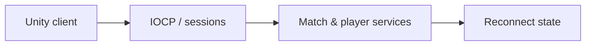

# CodeName VAIS — Game Server

[English](README.md) · [Korean](README.ko.md) · [Japanese](README.ja.md)

**C++ · Windows IOCP · C# · Unity** · 현재 개발 중

[개발 사례 보기](https://ysl-ryudo.github.io/ko/work/vector/) · [Portfolio](https://ysl-ryudo.github.io/ko/)

정식 명칭은 **CodeName VAIS**이며 **Project Vector**는 이전 임시 이름입니다. 저장소명은 유지합니다.

**2026.03 - 현재 · 10명 · 소프트웨어 5명, 그래픽 5명**

서버 개발·Unity 멀티플레이 연동

CodeName VAIS와 연결되는 C++ Windows 서버입니다. 팀 Unity 클라이언트와 구분해 제가 작업한 서버 구현을 정리합니다.

## 해결하려던 문제

멀티플레이 FPS에서는 통신뿐 아니라 경기 수명주기와 플레이어에게 보이는 상태가 연결되어야 합니다. 재접속에서는 복구할 상태와 다시 실행하면 안 되는 행동을 구분해야 합니다.

## 내 구현과 설계

IOCP 서버의 세션·패킷 처리부터 Unity의 경기·프로필·상점 연동, 재접속 시 표시 상태 복원까지 작업했습니다. ReconnectJournal에는 지속 상태를 보관하고 피해·보상·플레이어 명령 재실행은 제외했습니다.

### 구현 개요 · 개념 흐름도

### 개발 시연 영상

- [Lobby UI](https://www.youtube.com/watch?v=WqRBn-yWVdo)
- [Store system](https://www.youtube.com/watch?v=OBFWkZE2rzo)
- [Profile system](https://www.youtube.com/watch?v=A3CkQvnQEGI)
- [Earlier Project Vector demo](https://www.youtube.com/watch?v=oga4ai_1Ugg)

촬영 당시의 프로젝트 시연입니다. 게임 안에서 제가 맡은 작업은 아래 기여 항목으로 구분합니다.

## 내 기여

- 게임 클라이언트를 위한 IOCP 연결 처리, 세션과 패킷 디스패치를 구현했습니다.
- 방·경기 수명주기, 프로필·커리어 데이터, 소셜 기능, 상점 서비스와 클라이언트 규격을 작업했습니다.
- 재접속 시 표시 상태 복원과 파티·팀 음성 권한 처리를 추가했습니다. ReconnectJournal은 피해·보상·플레이어 명령을 재실행하지 않고 지속 상태를 보관합니다.

## 기여 근거

- [IOCP](https://github.com/YSL-RyuDo/ProjectVectorServer/blob/3066fe6d90fb4a56a6c440af56c4e119188e73fc/ProjectVectorServer/ProjectVectorServer/IocpCore.cpp)
- [ReconnectJournal](https://github.com/YSL-RyuDo/ProjectVectorServer/blob/3066fe6d90fb4a56a6c440af56c4e119188e73fc/ProjectVectorServer/ProjectVectorServer/ReconnectJournal.h)
- [Validation sources](https://github.com/YSL-RyuDo/ProjectVectorServer/tree/3066fe6d90fb4a56a6c440af56c4e119188e73fc/Tests)

커밋은 설명한 변경의 근거이며 기여율 점수가 아닙니다. 외부 에셋과 팀원 작업의 크레딧은 구분합니다.

## 실행·코드 확인

Windows C++ 워크로드가 설치된 Visual Studio에서 [ProjectVectorServer/ProjectVectorServer.sln](ProjectVectorServer/ProjectVectorServer.sln)을 여세요. 구성·데이터 경로·의존성·접속 설정을 확인한 뒤 대응하는 클라이언트를 실행하세요. 기존 계정 데이터를 보존하세요.

[projectVector](https://github.com/YSL-RyuDo/projectVector)

## 개발·검증 범위

현재 개발 중입니다. 재접속·경기 수명주기·상점·소셜·음성 규격 테스트 소스가 있지만, 소스 존재 자체가 현재 버전의 통과 기록은 아닙니다. 음성 검증 기록과 남은 두 PC 검사는 Docs/VoiceChatSetup.md를 확인하세요. 현재 TCP에는 TLS가 없으며 문서의 개발 환경은 신뢰 LAN/VPN입니다. IOCP 사용만으로 측정된 확장성을 주장하지 않습니다.

## 상세 문서

- [Docs/VoiceChatSetup.md](Docs/VoiceChatSetup.md)
- [Docs/CombatReportProtocol.md](Docs/CombatReportProtocol.md)

## 구현을 확인하는 방법

IOCP 코어, ReconnectJournal, 규격 테스트를 함께 보면 설계 의도를 따라갈 수 있습니다. 테스트 소스의 범위와 새로 수행하는 두 클라이언트 경기·두 PC 음성 검증은 구분합니다.
