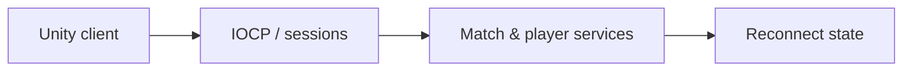

# CodeName VAIS — Game Server

[English](README.md) · [Korean](README.ko.md) · [Japanese](README.ja.md)

**C++ · Windows IOCP · C# · Unity** · Active development

[Explore the case](https://ysl-ryudo.github.io/en/work/vector/) · [Portfolio](https://ysl-ryudo.github.io/en/)

**CodeName VAIS** is the official project name; **Project Vector** was the working title. Repository names are retained.

The C++ Windows server paired with Project Vector. This repository documents my server implementation separately from the team's Unity client.

## The engineering problem

A multiplayer FPS has to connect transport, match lifecycle and player-facing state. Rejoining a session also requires deciding what state to restore and what actions must not run again.

## My implementation

I worked across the IOCP server and Unity integration: sessions and packet dispatch, match/profile/shop flows, and reconnect presentation-state recovery. ReconnectJournal retains persistent state while excluding damage, rewards and player-command replay.

### Implementation overview · conceptual flow

### Development videos

- [Lobby UI](https://www.youtube.com/watch?v=WqRBn-yWVdo)
- [Store system](https://www.youtube.com/watch?v=OBFWkZE2rzo)
- [Profile system](https://www.youtube.com/watch?v=A3CkQvnQEGI)
- [Earlier Project Vector demo](https://www.youtube.com/watch?v=oga4ai_1Ugg)

Recorded project demonstrations; the contribution section below identifies my work within the game.

## My contribution

- Implemented IOCP connection handling, sessions and packet dispatch for the game client.
- Worked on room/match lifecycle, profile and career data, social features, shop services, and their client contracts.
- Added reconnect presentation-state recovery and party/team voice authorization. ReconnectJournal stores persistent state instead of replaying damage, rewards or player commands.

## Contribution evidence

- [IOCP](https://github.com/YSL-RyuDo/ProjectVectorServer/blob/3066fe6d90fb4a56a6c440af56c4e119188e73fc/ProjectVectorServer/ProjectVectorServer/IocpCore.cpp)
- [ReconnectJournal](https://github.com/YSL-RyuDo/ProjectVectorServer/blob/3066fe6d90fb4a56a6c440af56c4e119188e73fc/ProjectVectorServer/ProjectVectorServer/ReconnectJournal.h)
- [Validation sources](https://github.com/YSL-RyuDo/ProjectVectorServer/tree/3066fe6d90fb4a56a6c440af56c4e119188e73fc/Tests)

Commits are evidence of the stated changes, not a percentage-of-authorship score. Third-party assets and teammates' work remain separately credited.

## Open and inspect

Open [ProjectVectorServer/ProjectVectorServer.sln](ProjectVectorServer/ProjectVectorServer.sln) in Visual Studio with the Windows C++ workload. Inspect the selected configuration, data paths, dependencies and endpoint settings before starting the matching client. Preserve existing account data.

[projectVector](https://github.com/YSL-RyuDo/projectVector)

## Development and verification scope

Active development. Test sources cover reconnect, match lifecycle, shop and social/voice contracts; their presence alone is not a current passing test report. Consult Docs/VoiceChatSetup.md for the recorded voice checks and remaining two-PC tests. Current TCP transport is not TLS-protected; the documented development setup uses a trusted LAN/VPN. Do not interpret IOCP usage as a measured scalability result.

## Further documentation

- [Docs/VoiceChatSetup.md](Docs/VoiceChatSetup.md)
- [Docs/CombatReportProtocol.md](Docs/CombatReportProtocol.md)

## How to evaluate the work

Read the IOCP core, ReconnectJournal and contract-test sources together. Separate the checked-in test coverage from a new two-client match or two-PC voice run.
